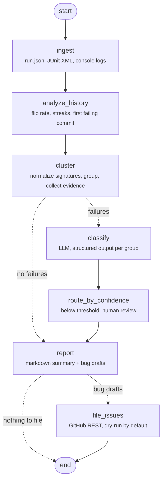

# ci-failure-triage-agent

> New here? Start with [docs/walkthrough.md](docs/walkthrough.md).

A LangGraph pipeline that triages CI test failures. It reads JUnit XML and console
logs from recent CI runs, works out which failures are flaky, groups failures by
root signature, classifies each group (product bug / flaky test / environment /
test-code bug) with Claude, and drafts bug reports, optionally filing them as
GitHub issues.

## Problem

When a pipeline goes red, someone has to answer the same questions every time:
is this a real regression or a flake? Did the environment fall over? Which commit
broke it, and who owns it? Doing it by hand means opening several runs, diffing
stack traces and scrolling job logs. Most of that is mechanical. The judgement
call at the end is the part worth handing to a model, and only once the
evidence is in front of it.

## How it works



| Node | Deterministic? | What it does |
|---|---|---|
| `ingest` | yes | Loads `runs/<run_id>/run.json` (commit, branch, timestamp), every JUnit XML file under the run (Surefire and pytest flavours via `junitparser`), and `console.log`. |
| `analyze_history` | yes | Per test: fail rate, **same-commit flip rate** (commits that were rerun and changed outcome), outcome transitions, trailing failure streak, **first failing commit** and last passing commit. |
| `cluster` | yes | Builds a signature from exception type + normalized message + top in-app stack frame(s). Normalization strips UUIDs, timestamps, IPs, hex addresses, temp paths and numbers; frames drop line numbers and framework code (JUnit, JDK, site-packages). Each group gets an evidence bundle: tests, runs, flip rate, setup-phase flag, infra signals from messages and job logs, suspect commits, code areas, log excerpt. |
| `classify` | no | Sends the evidence bundle to Claude and parses the reply into a pydantic `Classification` (category, confidence, rationale, suspected commit, suggested owner area). |
| `route_by_confidence` | yes | Items below the confidence threshold (default 0.7) go to a "Needs human review" section and are never filed. |
| `report` | yes | Markdown report plus one bug-report draft per product or test-code bug: repro commands, last good / first bad commit, evidence, trace and log excerpts. |
| `file_issues` | yes | Dry-run by default: writes issue payloads to disk. With `--no-dry-run` it creates GitHub issues, skipping any whose signature is already in an open issue. |

## Quick start (mock mode, no API key)

```bash
python3.12 -m venv .venv
.venv/bin/pip install -e ".[dev]"

.venv/bin/triage run --input sample_data --out reports/
```

```
classifier: mock
runs: 9  signatures: 6  needs review: 1
  96c4992c80  product_bug    0.85  1 test(s)
  a8252e02cf  test_code_bug  0.85  2 test(s)
  af8af61825  flaky_test     0.80  1 test(s)
  eacf7aa34b  environment    0.90  3 test(s)
  3f511f3805  environment    0.90  2 test(s)
  08f85f9f62  product_bug    0.55  1 test(s)  [review]
  issue 96c4992c80: dry-run reports/issues/96c4992c80.json
  issue a8252e02cf: dry-run reports/issues/a8252e02cf.json
report: reports/triage-report.md
```

Outputs in `reports/`:

- `triage-report.md` is the full report ([committed example](docs/sample-triage-report.md))
- `triage.json` holds the evidence and classification for every group, for dashboards or further tooling
- `bugs/<signature>.md` has one bug-report draft per bug
- `issues/<signature>.json` has the GitHub issue payloads (dry-run)

`triage graph` prints the compiled LangGraph as Mermaid.

## Running with Claude

```bash
export ANTHROPIC_API_KEY=...
export LLM_PROVIDER=anthropic          # default when ANTHROPIC_API_KEY is set
export LLM_MODEL=claude-sonnet-5-5     # optional, this is the default
.venv/bin/triage run --input sample_data --out reports/
```

The classifier uses the Anthropic SDK's `messages.parse()` with the `Classification`
pydantic model as the output format, so the reply is schema-validated. If the call
fails, the model declines (`stop_reason == "refusal"`) or no structured output
comes back, the group gets confidence 0.0 and lands in human review. It is never
silently dropped or auto-filed.

Filing issues for real:

```bash
export GITHUB_TOKEN=...   # needs issues:write on the target repo
.venv/bin/triage run --input <history> --out reports/ --no-dry-run --repo owner/name
```

Options: `--threshold` (review cut-off), `--frame-depth` (frames per signature),
`--provider`, `--model`.

## Sample data

`sample_data/` has nine synthetic CI runs on `main` for a service with a Java
module (Surefire XML) and a pytest API suite, including reruns of the same commit.
It plants one of each failure type. See [sample_data/README.md](sample_data/README.md)
for the run-by-run table.

| Planted problem | What the evidence shows | Result |
|---|---|---|
| Pricing regression | Passes through `7b8e4d0`, fails in all 6 runs from `9c41e7a`, reruns agree | product_bug, suspect `9c41e7a` |
| Timing-based checkout test | Flips pass/fail on reruns of 2 of 3 rerun commits | flaky_test |
| DB container OOM-killed, DNS failure | 5 unrelated tests fail only in `r1006`; job log shows `OOMKilled` and `no such host` | environment (2 groups) |
| Fixture refactor breaks `setUp` | NPE in test class `setUp`, every run since `e7a1b52` | test_code_bug, suspect `e7a1b52` |
| CSV header order | Fails once, in the latest run only | product_bug at 0.55, sent to human review |

## Sample triage report (excerpt)

Full report: [docs/sample-triage-report.md](docs/sample-triage-report.md)

| Signature | Category | Tests | Failing runs | Latest run | Confidence | Action |
|---|---|---|---|---|---|---|
| `96c4992c80` | product_bug | 1 | 6/9 | fail | 0.85 | File bug (draft below) |
| `a8252e02cf` | test_code_bug | 2 | 3/9 | fail | 0.85 | File bug for test owners (draft below) |
| `af8af61825` | flaky_test | 1 | 3/9 | pass | 0.80 | Quarantine + stabilise |
| `eacf7aa34b` | environment | 3 | 1/9 | pass | 0.90 | Infra follow-up, rerun |
| `3f511f3805` | environment | 2 | 1/9 | pass | 0.90 | Infra follow-up, rerun |
| `08f85f9f62` | product_bug | 1 | 1/9 | fail | 0.55 | Needs human review |

## Using it in CI

[`examples/triage-on-failure.yml`](examples/triage-on-failure.yml) shows a test
workflow that uploads JUnit XML on every run, plus a `triage` job that runs only
when tests fail. That job downloads the same artifact from the last N runs on the
branch with `gh`, writes a `run.json` per run, runs the agent, and posts the
report to the job summary. Issue filing stays commented out until the team trusts
the output.

This repo's own CI ([`.github/workflows/ci.yml`](.github/workflows/ci.yml)) runs
ruff, pytest, and the mock-mode demo. It also diffs the demo output against
`docs/sample-triage-report.md`, so any behaviour change shows up in review.

## Design decisions

- **Deterministic signals first, LLM second.** Parsing, flip rates, first-failing
  commit, signature grouping and infra-keyword detection are plain code. They are
  cheap, testable and reproducible. The model gets a compact evidence bundle, not
  raw logs, and is told to treat that evidence as ground truth. This keeps
  token cost flat as history grows and makes each classification auditable.
- **Same-commit flips are the flakiness signal.** A test that passes and fails on
  the same commit is flaky by definition. A single failure followed by recovery
  is *not* treated as flaky; that pattern usually points at the environment.
- **Confidence and human-in-the-loop.** Every classification carries a
  confidence. Anything under the threshold, and any LLM error or refusal, goes to
  "Needs human review" and is never drafted or filed.
- **Dry-run by default.** Issue filing is opt-in (`--no-dry-run`). Each issue body
  carries a `triage-signature` marker, and existing open issues with the same
  signature are skipped, so re-running the job does not spam the tracker.
- **Mock provider as a first-class citizen.** `LLM_PROVIDER=mock` swaps in a
  rule-based classifier that follows the same guidance as the system prompt. The
  full pipeline, tests and CI run without an API key or network access.

## Project layout

```
src/ci_triage/
  ingest.py       run metadata, JUnit XML (junitparser), console logs
  flakiness.py    per-test history: flip rate, streaks, first failing commit
  signatures.py   message normalization, frame extraction, signature ids
  clustering.py   grouping + evidence bundle (infra signals, suspects, logs)
  llm.py          Anthropic classifier (structured output) and mock classifier
  report.py       markdown report and bug drafts
  issues.py       GitHub issue filing (httpx), dry-run default, dedup by signature
  graph.py        LangGraph wiring
  cli.py          `triage run`, `triage graph`
scripts/generate_sample_data.py   regenerates sample_data/ deterministically
tests/                            pytest suite (parsers, normalization, flakiness math, graph, report, issues, CLI)
```

## Development

```bash
.venv/bin/pytest
.venv/bin/ruff check . && .venv/bin/ruff format --check .
.venv/bin/python scripts/generate_sample_data.py   # only if the scenario changes
```

## Limitations and next steps

- **Mock classifier.** The mock encodes the prompt's decision rules, so on the
  sample data it agrees with the planted scenarios by construction. The real
  model has not been evaluated here (no API key was used during development). A
  labelled set of historical failure groups and an agreement/precision report per
  category would be the first thing to add before trusting it.
- **Signature grouping is heuristic.** One in-app frame per signature groups
  failures that go through a shared helper (the three DB tests), but it can merge
  unrelated failures that share a helper and message. `--frame-depth` trades
  that off. Cross-language incidents (the DB and DNS groups in the same run)
  remain separate groups. A run-level "incident" view would link them.
- **History comes from what you feed it.** Flip rates need reruns. First-failing
  commit is only as precise as the commits CI actually ran; it gives a range, not
  a bisect.
- **No automatic quarantine or rerun.** Flaky and environment groups get a
  recommended action, not an automated one.
- **Issue dedup is signature-based.** If a message changes shape enough to get a
  new signature, a duplicate issue is possible. Linking to issues filed by hand
  is not handled.
- Next: persist history across jobs (SQLite) instead of re-downloading artifacts,
  add a GitLab/Jenkins artifact collector, and add LangGraph `interrupt()` so a
  reviewer can approve or re-label review items before filing.
